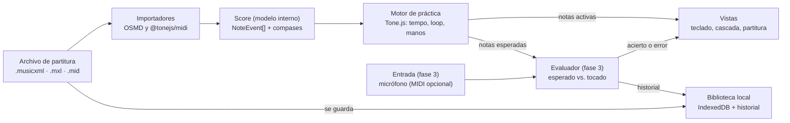

# Piano APP — Spec y arquitectura

30/10/2026 · Wally · Versión viva: [Claude Doc](https://claude.ai/artifact/3h9rki6Xc2L8HtagnUHzCP)

## Visión y objetivos

Piano APP convierte una partitura (MusicXML o MIDI) en un teclado animado que muestra qué teclas tocar en cada nota o acorde, para practicar por secciones a tu tempo y, en una fase posterior, recibir una devolución escuchando por el micrófono.

- **Para quién:** pianistas principiantes e intermedios que leen poco o lento la partitura y aprenden mejor viendo las teclas.
- **Dónde corre:** localmente en esta PC (navegador), con el código alojado en GitHub. Sin backend ni cuentas en la v1.
- **Prioridad de diseño:** el front es el producto. Mobile-first: tiene que verse y usarse bien en un teléfono apoyado en el atril, en horizontal.

Tres resultados definen el éxito de la v1:

1. Cargar un MusicXML o MIDI propio y verlo en el teclado en menos de 5 segundos.
2. Elegir un rango de compases, bajar el tempo y repetirlo en loop.
3. Que la app escuche al usuario y marque qué notas acertó, usando el micrófono del celular (fase 3).

## Requisitos funcionales

La v1 cubre los cuatro módulos. El 4 (micrófono) es el de más riesgo técnico, por eso arranca con la calibración y con notas sueltas.

### 1. Carga de partituras

- Abrir un archivo local: MusicXML (`.musicxml`, `.xml`), MusicXML comprimido (`.mxl`) y MIDI (`.mid`). Arrastrar y soltar en escritorio, selector de archivos en mobile.
- Normalizar todo a un modelo interno único de eventos (ver Arquitectura) para que el resto de la app no sepa de qué formato vino.
- Biblioteca local: las partituras cargadas quedan guardadas en el navegador (IndexedDB) con título, fecha y último tempo y sección usados.
- Incluir 2 o 3 partituras de ejemplo de dominio público para probar sin tener archivos.
- PDF (el formato que usa Wally): se convierte en la PC con Audiveris, un OMR open source, con `npm run pdf -- pieza.pdf`, que corre `audiveris -batch -transcribe -export -output scores/ pieza.pdf` y deja `pieza.mxl`. El reconocimiento comete errores, así que la app muestra la partitura renderizada para revisarla y, si hace falta, se corrige en MuseScore. Las partituras propias quedan fuera del repo (carpeta en `.gitignore`) porque el repo es público.

### 1.1 PDF con varias obras (colecciones)

Un PDF puede traer una sola obra o una colección (un cuaderno de estudios, un álbum). La app lo detecta y, si es una colección, lista cada obra por separado para elegirla. Entra en la fase 4; no cambia lo ya hecho.

- **Detección automática:** Audiveris ya separa "movimientos" cuando el primer sistema de una obra está sangrado, y exporta un archivo por obra (`pieza.mvt1.mxl`, `pieza.mvt2.mxl`, …). Si sale más de un archivo, el script lo trata como colección.
- **Nombres:** cada obra toma el título que Audiveris lee del encabezado (OCR); si no hay, queda como "Obra 3 (pág. 7)" y se puede renombrar.
- **Interfaz:** en la Biblioteca la colección aparece como un grupo desplegable con sus obras en orden, cada una con su propio progreso, secciones e historial.
- **Marcar a mano:** al subir el PDF hay una casilla "Es una colección". Si Audiveris no detectó cortes (pasa en antologías sin sangría), la app muestra las páginas en miniatura y el usuario marca dónde empieza cada obra. El script vuelve a correr Audiveris por rangos con `-sheets` (por ejemplo `-sheets 1-2`, `-sheets 3-5`) y obtiene una obra por rango.
- **Corregir:** se puede unir dos obras que se cortaron mal, o separar una en dos, sin volver a subir el PDF.

```ts
interface Collection { id: string; title: string; pdfName: string; scoreIds: string[] } // en orden
// Score suma: collectionId?: string; pages?: [number, number]
```

### 2. Teclado visual y partitura

- Teclado de 88 teclas dibujado en SVG, con zoom y desplazamiento al rango que usa la pieza (en mobile se muestran 2 a 3 octavas y sigue la música).
- En cada nota o acorde se iluminan las teclas a tocar. Color distinto por mano (derecha / izquierda, tomado del pentagrama o del canal MIDI).
- Anticipación: las próximas notas se ven en tono tenue antes de sonar. Modo opcional de "cascada" (barras que caen hacia el teclado).
- Partitura renderizada arriba del teclado (solo para MusicXML) con un cursor sincronizado al compás actual. En mobile horizontal la partitura se reduce a un sistema.
- Digitación: si el MusicXML trae números de dedo, se muestran sobre la tecla.
- Nombres de nota opcionales en las teclas (Do-Re-Mi o C-D-E).

### 3. Práctica por secciones y tempo

- Reproducción con sonido de piano, play / pausa / volver al inicio de la sección.
- Elegir sección por rango de compases (desde / hasta) y repetirla en loop. Secciones guardadas con nombre por partitura.
- Tempo de 25 % a 150 % del original, en pasos de 5 %, sin cambiar la afinación.
- Metrónomo con cuenta previa de 1 compás.
- Manos separadas: tocar o mostrar solo derecha, solo izquierda, o ambas.
- Modo "espera": la reproducción se detiene en cada acorde hasta que el usuario toca la nota correcta (escuchando con el micrófono del celular; con teclado MIDI si se conecta).
- Subida de tempo automática opcional: +5 % cada N loops sin errores.

### 4. Evaluación por micrófono (fase 3)

- Antes de evaluar por primera vez, la app pide permiso de micrófono y corre la calibración inicial (ver 4.1).
- Durante la práctica, detectar las notas que suenan y compararlas con las esperadas en una ventana de tiempo.
- Devolución en vivo: tecla verde si acertó, roja si fue otra nota, gris si faltó.
- Devolución al terminar: % de notas correctas, % a tiempo, compases con más errores y sugerencia ("repetir compases 9 a 12 al 70 %").
- Historial de sesiones por partitura para ver el progreso.
- Camino principal: el micrófono del celular escucha los parlantes del Casio CDP-S110. Opcional: con un cable USB OTG el Casio manda las notas por Web MIDI, exactas, al mismo motor de evaluación.

### 4.1 Calibración inicial (tuning)

Un asistente de 1 a 2 minutos le pide al usuario tocar notas concretas para que la app aprenda cómo suena *su* piano en *su* habitación con *su* teléfono. Es obligatorio antes de la primera evaluación y se puede repetir desde Ajustes.

1. **Silencio (3 s):** mide el ruido de fondo y fija el umbral a partir del cual algo cuenta como nota.
2. **La4 sostenido:** mide la frecuencia real del La4 y guarda el desvío en cents. Un piano desafinado 30 cents abajo sigue reconociéndose bien.
3. **Una nota por registro (Do2, Do4, Do6):** comprueba que se detectan graves, medios y agudos, y ajusta la sensibilidad por registro. Si un registro falla, la app lo avisa ("tu micrófono no capta bien los graves").
4. **Tocar junto al metrónomo (4 golpes en Do4):** el promedio del desfase entre el clic y la nota detectada es la latencia de entrada del dispositivo; el evaluador la resta antes de juzgar si una nota fue a tiempo.
5. **Acorde de Do mayor (Do4-Mi4-Sol4):** prueba si el dispositivo detecta acordes. Si no, la evaluación de esa sesión se limita a notas sueltas y lo dice.

El resultado se guarda como perfil por dispositivo en IndexedDB:

```ts
interface CalibrationProfile {
  deviceId: string; date: string;
  noiseFloorDb: number;         // umbral de ruido
  a4Hz: number; centsOffset: number;
  latencyMs: number;            // latencia de entrada medida
  registerGain: { low: number; mid: number; high: number };
  chordsSupported: boolean;
}
```

Con teclado MIDI solo se corre el paso 4 (latencia), porque las notas llegan exactas. La app sugiere recalibrar si cambia el dispositivo de entrada o si en una sesión más del 30 % de las notas quedan como "no detectadas".

## Requisitos no funcionales

La app es una web estática que corre en el navegador: se levanta con `npm run dev` en la PC y el teléfono la abre por la red local.

| Tema | Requisito |
| --- | --- |
| Local-first | Sin backend ni login. Partituras, secciones e historial en IndexedDB del navegador. Funciona sin internet después de la primera carga (PWA). |
| Mobile | Diseño mobile-first, uso principal en horizontal. Botones de al menos 44 × 44 px. Dispositivo principal: Android con Chrome (soporta Web MIDI y micrófono); Safari iOS es secundario. |
| Acceso desde el teléfono | Vite con `--host` para abrir la app desde el teléfono en la misma Wi-Fi. El micrófono exige HTTPS fuera de `localhost`, así que la fase 4 usa un certificado local (plugin de Vite o mkcert). |
| Fluidez | Animación del teclado a 60 fps en un teléfono de gama media. Desfase entre sonido y tecla iluminada menor a 30 ms. |
| Audio | El audio arranca tras un toque del usuario (regla de los navegadores). Muestras de piano cargadas una sola vez y cacheadas. |
| Latencia de evaluación | Feedback de nota acertada en menos de 150 ms desde que suena. |
| Accesibilidad | Contraste AA, los colores de mano también se distinguen por forma o etiqueta, controles usables con teclado físico. |
| Privacidad | El audio del micrófono se procesa en el dispositivo y nunca se sube. |
| Calidad | TypeScript estricto, tests unitarios del parser, del modelo de eventos y del evaluador. CI en GitHub Actions con lint, tests y build. |

## Stack recomendado

React + TypeScript + Vite en el front, Tone.js para sonido y tiempo, OpenSheetMusicDisplay para la partitura, y un teclado SVG propio. Nada de backend. Las APIs se verificaron con Context7 (documentación oficial de cada librería) el 30/10/2026.

| Capa | Elección | Por qué |
| --- | --- | --- |
| Base | [React](https://react.dev) + TypeScript + [Vite](https://vite.dev) | Lo que ya usa el prototipo. Arranque rápido, `vite --host` para probar en el teléfono. |
| Estilos | CSS plano con variables CSS (lo que usa el prototipo) | Tema claro/oscuro y colores de mano como tokens. Sin librería de componentes: la UI es a medida. |
| Estado | [Zustand](https://zustand.docs.pmnd.rs) | Un store chico para partitura, transporte y ajustes; el teclado se suscribe solo a las notas activas. |
| Partitura | [OpenSheetMusicDisplay](https://github.com/opensheetmusicdisplay/opensheetmusicdisplay) | Renderiza MusicXML/MXL con VexFlow y trae un cursor que recorre las notas con su `halfTone` y tiempo. |
| MIDI | [@tonejs/midi](https://github.com/Tonejs/Midi) | Convierte un `.mid` a pistas y notas en JSON con tiempos en segundos y compases. |
| Audio y tiempo | [Tone.js](https://tonejs.github.io) | `Transport` con `bpm`, `loop`, `loopStart` y `loopEnd` resuelve tempo y loop de sección; `Sampler` toca muestras de piano reales. |
| Teclado | SVG propio en React | 88 teclas son 88 `<rect>`: no justifica una librería y da control total del diseño. |
| Cascada (opcional) | Canvas 2D | Muchas barras animadas a 60 fps rinden mejor en canvas que en DOM. El prototipo usa DOM y pasa a canvas en la fase 3. |
| Persistencia | IndexedDB vía [idb-keyval](https://github.com/jakearchibald/idb-keyval) | Guardar archivos de partitura, secciones e historial con 2 funciones. |
| PWA | [vite-plugin-pwa](https://vite-pwa-org.netlify.app) | Instalar en el teléfono y usar sin red. |
| Entrada MIDI | Web MIDI API (nativa) | Opcional, con cable OTG: notas exactas para el modo espera y la evaluación. No funciona en Safari iOS. |
| Micrófono, notas sueltas | [Pitchy](https://github.com/ianprime0509/pitchy) (McLeod) sobre `AnalyserNode` | Liviano, en tiempo real, suficiente para melodías de una nota. |
| Micrófono, acordes | [Basic Pitch](https://github.com/spotify/basic-pitch) de Spotify (modelo TensorFlow.js, paquete `@spotify/basic-pitch`) | Transcripción polifónica audio a notas en el navegador. Procesa ventanas de 2 s a 22 050 Hz, así que se usa con algo de retraso, no nota a nota. |
| Tests | [Vitest](https://vitest.dev) + Testing Library, Playwright para un flujo end-to-end | Mismo config que Vite. |
| CI | GitHub Actions | Lint, tests y build en cada PR. Deploy a GitHub Pages en cada merge a `main` (repo público): el teléfono abre la app con HTTPS sin configurar certificados. |

Descartados: Next.js (no hace falta servidor), un framework móvil nativo (la PWA alcanza para la v1; Capacitor queda como opción si se quiere publicar en tiendas) y Magenta.js (sin mantenimiento activo).

Herramienta externa: [Audiveris](https://github.com/audiveris/audiveris) (OMR open source, Java) instalado en la PC para pasar PDF a MusicXML. No es parte de la app; un script de npm lo invoca en modo batch.

## Arquitectura

Cada formato de entrada se convierte en un único modelo de notas (`Score`), y todo lo demás (teclado, sonido, loop, evaluación) lee de ese modelo. Así agregar un formato nuevo no toca la UI.



El motor de práctica es el único reloj: dice qué notas están activas y esas mismas notas son las que el evaluador espera escuchar.

### Modelo de datos

```ts
type Hand = 'L' | 'R';

interface NoteEvent {
  midi: number;      // 21 (La0) a 108 (Do8)
  time: number;      // segundos desde el inicio, a tempo original
  duration: number;  // segundos
  hand: Hand;
  measure: number;   // compás, empieza en 1
  finger?: number;   // 1 a 5, si la partitura lo trae
}

interface Score {
  id: string;
  title: string;
  bpm: number;
  timeSignature: [number, number];
  measures: { index: number; start: number }[]; // inicio de cada compás en segundos
  notes: NoteEvent[];                            // ordenadas por time
  source: { kind: 'musicxml' | 'midi'; fileName: string };
}

interface Section { id: string; scoreId: string; name: string; fromMeasure: number; toMeasure: number }

interface Attempt {
  scoreId: string; sectionId?: string; date: string; tempoPct: number;
  hits: number; wrong: number; missed: number; avgOffsetMs: number;
}
```

Un acorde son varios `NoteEvent` con el mismo `time`. El tempo de práctica no cambia el modelo: el motor escala el reloj con `Transport.bpm`.

### Módulos

- **Importadores** (`src/import/`): `fromMusicXml(file)` usa OSMD y su cursor (nota, `halfTone`, tiempo, compás, pentagrama para la mano); `fromMidi(file)` usa @tonejs/midi (pista o canal para la mano). Ambos devuelven `Score`.
- **Motor de práctica** (`src/engine/`): programa las notas en un `Tone.Part`, maneja `loopStart` / `loopEnd` por compás, tempo, metrónomo, manos y modo espera. Publica `activeNotes` y `currentMeasure` en el store.
- **Vistas** (`src/components/`): `Keyboard` (SVG), `Waterfall` (canvas), `ScoreView` (OSMD con cursor), `TransportBar` (play, tempo, sección). Solo leen el store.
- **Evaluador** (`src/eval/`): función pura `match(expected, played, toleranceMs) => Result` que no sabe de audio. Las fuentes (`MicSource` con Pitchy o Basic Pitch, `MidiSource` con Web MIDI) emiten `{ midi, time }`.
- **Persistencia** (`src/storage/`): guarda el archivo original y el `Score` parseado, secciones e intentos.

### Estructura de carpetas

```text
piano_app/
  docs/SPEC.md
  public/samples/piano/    muestras del Sampler
  public/scores/           partituras de ejemplo
  src/
    import/                musicxml.ts, midi.ts
    model/                 types.ts
    engine/                transport.ts, sections.ts
    eval/                  match.ts, mic.ts, midiInput.ts
    storage/               db.ts
    store/                 usePlayer.ts (Zustand)
    components/            Keyboard, Waterfall, ScoreView, TransportBar
    pages/                 Library, Practice, Results
  tests/
```

Tres pantallas: **Biblioteca** (lista y carga), **Práctica** (partitura, teclado y controles) y **Resultados** (devolución de la sesión y progreso).

## Roadmap

Cinco fases; al cerrar la fase 2 ya hay una app usable para practicar, y la fase 3 suma el micrófono, que es lo más incierto.

| Fase | Incluye | Terminado cuando |
| --- | --- | --- |
| 0 · Base | Vite + React + TS, CI y GitHub Pages, teclado SVG estático, tema visual | El teclado de 88 teclas se ve bien en el teléfono en horizontal |
| 1 · Ver | PDF a MusicXML (Audiveris), carga, `Score`, teclado ilumina notas, sonido | Un ejemplo suena y se ilumina en sincronía (menos de 30 ms) |
| **2 · Practicar** | Secciones, loop, tempo 25 a 150 %, metrónomo, manos, partitura | Loop de compases 5 a 8 al 50 % sin cortes ni desfase |
| 3 · Escuchar | Calibración, micrófono (Pitchy), modo espera, devolución, historial | 90 % o más de notas sueltas detectadas con el celular frente al Casio |
| 4 · Pulir | Acordes (Basic Pitch), colecciones de PDF (1.1), biblioteca, PWA, cascada canvas, MIDI opcional | Se instala en el teléfono, anda sin red y detecta acordes de 3 notas |

La evaluación por micrófono llega en la fase 3, empezando por la calibración; los acordes con Basic Pitch y el MIDI opcional quedan para la fase 4. Cada fase termina en un PR a `main` con la app funcionando. La fase 3 empieza con un prototipo aislado de detección (una página que muestra qué nota escucha) antes de integrarlo, para medir la precisión con el piano real.

## Riesgos y preguntas abiertas

El riesgo mayor es la detección de acordes por micrófono; el plan lo aísla en la fase 4 y ofrece el teclado MIDI como camino preciso.

| Riesgo | Impacto | Mitigación |
| --- | --- | --- |
| Detectar acordes con el micrófono del teléfono es impreciso (armónicos, eco, ruido) | La devolución marca errores que no existen | Calibración inicial obligatoria (ver 4.1) que ajusta umbral, afinación y latencia al equipo real; empezar con melodías de una nota (Pitchy), sumar Basic Pitch para acordes con tolerancia amplia, y dejar el MIDI por cable OTG como alternativa exacta |
| Basic Pitch analiza ventanas de 2 s | Feedback de acordes con retraso | Feedback en vivo solo para notas sueltas; acordes evaluados al final del loop |
| El micrófono exige HTTPS fuera de `localhost` | No anda desde el teléfono en la red local | GitHub Pages (repo público) ya da HTTPS; para desarrollo local, certificado con mkcert |
| Web MIDI no existe en Safari iOS | Sin modo espera con MIDI en iPhone | No aplica por ahora: el dispositivo principal es Android |
| El OMR de los PDF (Audiveris) comete errores: notas, ritmos o manos mal leídas | Notas o manos mal asignadas | Revisar la partitura renderizada antes de practicar y corregir en MuseScore; preferir PDF digitales a escaneos; tests con archivos reales en `tests/fixtures` |
| Muestras de piano pesan varios MB | Primera carga lenta en el teléfono | Hoy salen del CDN de Tone.js; en la fase 3 se copian a `public/samples/piano/` (1 muestra cada 3 semitonos, el Sampler interpola) y se cachean con la PWA |

Respuestas de Wally (30/10/2026):

- [x] Piano: Casio CDP-S110, sin cable OTG. La evaluación usa el micrófono del celular (fase 3); MIDI queda opcional.
- [x] Partituras: en PDF. Se agrega la conversión con Audiveris en la fase 1.
- [x] Teléfono: Android. Se prueba primero en Chrome Android.
- [x] Repo: público. GitHub Pages como hosting con HTTPS desde la fase 0; las partituras propias no se suben.

## Fuentes

APIs verificadas con Context7 el 30/10/2026: [OpenSheetMusicDisplay, extracción de notas con el cursor](https://github.com/opensheetmusicdisplay/opensheetmusicdisplay/wiki/Tutorial---Extracting-note-timing-for-playing), [Tone.js Transport (bpm, loop)](https://github.com/tonejs/tonejs.github.io/blob/master/_autodocs/api-reference/transport.md), [Basic Pitch (ventana de 2 s a 22 050 Hz)](https://github.com/spotify/basic-pitch/blob/main/basic_pitch/constants.py).
